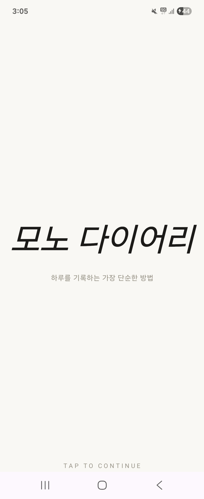
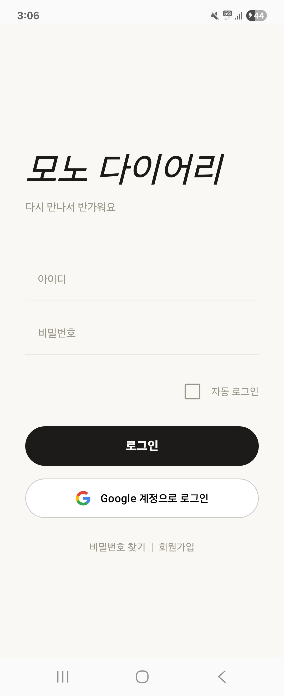
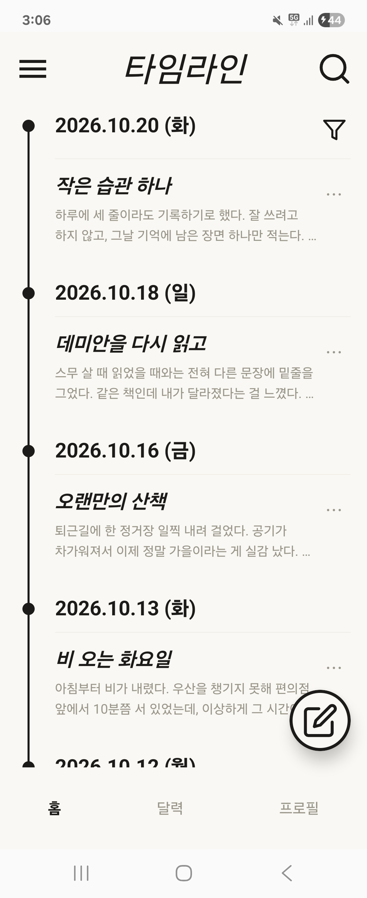
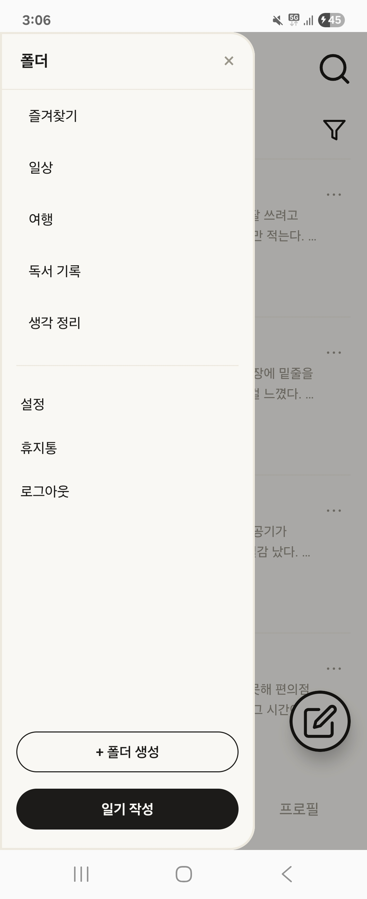
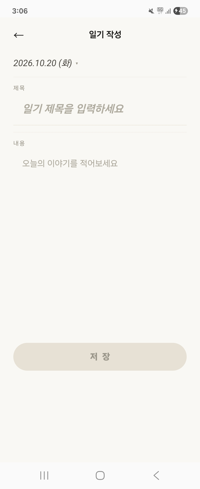
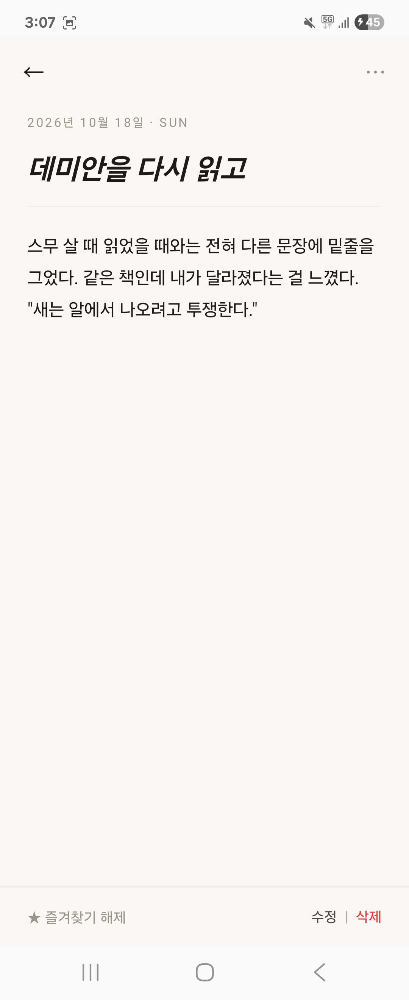
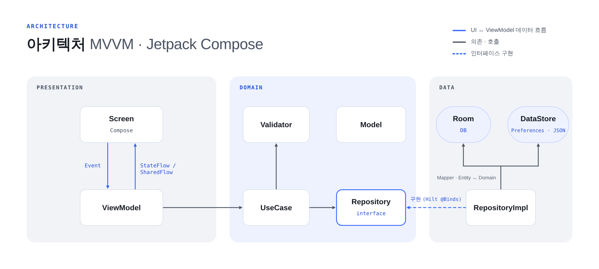

# 🗒️ 모노 다이어리

> 하루를 기록하는 가장 단순한 방법 — 모노톤 감성의 개인 다이어리 Android 앱

- **개발 형태:** 1인 개발 (기획 · 디자인 · 개발)
- **기간:** 2025.11 과제(약 1개월, [`v1.0-assignment`](https://github.com/its10623/Mono_Diary/tree/v1.0-assignment)) → 2026.08~ 기능 추가 및 개선
- **스택:** Kotlin · Jetpack Compose · Hilt · Room · DataStore · Coroutines/Flow

---

## 📱 스크린샷

| 시작 | 로그인 | 타임라인 |
|:---:|:---:|:---:|
|  |  |  |
| **폴더 드로어** | **일기 작성** | **일기 상세** |
|  |  |  |

---

## ✨ 핵심 구현 포인트

- **Clean Architecture + MVVM** — Presentation / Domain / Data 3계층 분리. `DiaryUseCase`와 Validator를 인터페이스로 두고 Hilt로 주입해 일기·폴더 입력 검증을 UI와 DB에서 독립
- **Room + Flow 반응형 목록** — DAO가 `Flow`를 반환하고 ViewModel에서 `combine`으로 정렬·날짜 필터를 조합. 타임라인/폴더 화면의 필터 상태는 `FilterScope`로 분리 → [트러블슈팅 1](#ts-1)
- **인증** — BCrypt 비밀번호 해시, DataStore 기반 자동 로그인, Credential Manager 기반 Google 로그인 → [트러블슈팅 2](#ts-2)
- **상태 호이스팅으로 UI 불일치 해결** — 시스템 뒤로가기 시 드로어 선택 표시가 어긋나던 문제를 route 기반 파생 상태로 수정 → [트러블슈팅 4](#ts-4)

---

## 🚀 주요 기능

**사용자**
- 회원가입 / 로그인 / 로그아웃
- Google 로그인
- 자동 로그인
- 비밀번호 재설정

**다이어리**
- 타임라인 (날짜별 그룹)
- 일기 작성 / 수정 / 삭제
- 폴더 생성 / 이름 변경 / 삭제
- 즐겨찾기
- 검색 (타임라인/폴더 각각 독립)
- 정렬 (최신순 / 오래된순), 날짜 필터 (화면별 독립)

> 달력·프로필 탭과 드로어의 설정·휴지통 메뉴는 UI만 구성된 상태이며 구현 예정입니다.

---

## 🧩 기술 스택 및 선택 이유

| 분류 | 기술 | 선택 이유 |
|---|---|---|
| UI | Jetpack Compose, Material3 | 선언형 UI로 상태 변화가 곧 화면 변화가 되도록 구성. 상태 호이스팅으로 화면 간 상태 소유권을 명확히 관리 |
| 아키텍처 | Clean Architecture, MVVM | 화면 로직과 비즈니스 규칙(검증), 데이터 접근을 분리해 각 계층을 독립적으로 수정 가능하게 |
| DI | Hilt | Repository·DiaryUseCase·Validator를 인터페이스로 분리하고 구현체를 주입하기 위해 |
| 로컬 DB | Room | 일기를 폴더·날짜·키워드로 조회해야 해서 쿼리가 가능한 DB가 필요. `Flow` 반환으로 데이터 변경이 화면에 자동 반영 |
| 설정 저장 | DataStore | 자동 로그인 등 설정값을 코루틴/Flow 기반으로 비동기 저장 (SharedPreferences 대체). 사용자 계정 목록은 kotlinx.serialization JSON으로 저장 |
| 비동기 | Coroutines, Flow | DB I/O를 메인 스레드에서 분리하고, `StateFlow`/`SharedFlow`로 상태와 일회성 이벤트를 구분 |
| 인증 | BCrypt, Credential Manager | 비밀번호는 평문 대신 해시로 저장. Google 로그인은 권장 API인 Credential Manager 사용 |

---

## 🏗️ 아키텍처



- **UiState:** 화면별 상태 클래스 (`LoginUiState`, `RegisterUiState` 등)
- **UiEvent:** `SharedFlow`로 로그인 성공, 에러 메시지 같은 일회성 이벤트 전달
- **Navigation:** `AppNavigation`의 `NavHost` 단일 진입점, `sealed class Screen`으로 라우트 정의

---

## 📁 프로젝트 구조

```
com.example.diaryapp
├── data
│   ├── local
│   │   ├── dataStore      # 사용자 계정(JSON) / 로그인 설정
│   │   └── room           # Entity, Dao, Database, TypeConverter
│   ├── mapper             # Entity <-> Domain 변환
│   └── repository         # Repository 구현체
│
├── domain
│   ├── model              # 순수 도메인 모델 (UI/DB와 독립)
│   ├── repository         # Repository 인터페이스
│   ├── validator          # 일기/폴더 입력 검증 규칙
│   └── usecase            # diary / user 유스케이스
│
├── presentation
│   ├── ui
│   │   ├── component      # 버튼, 카드, 텍스트필드, 타임라인 컴포넌트
│   │   ├── navigation     # AppNavigation (NavHost 단일 진입점)
│   │   ├── screen         # 화면 Composable + Screen 라우트 정의
│   │   ├── event          # 일회성 UI 이벤트 (sealed class)
│   │   ├── uiState        # 화면별 UI 상태
│   │   └── theme          # Color / Type / Theme
│   └── viewmodel          # 화면별 ViewModel
│
├── di                     # Hilt 모듈 (Repository / UseCase / Validator / DataStore)
├── DiaryApp.kt            # Application 클래스
├── MainActivity.kt        # Single Activity
└── SplashActivity.kt      # 초기 진입 Activity
```

---

## 🛠️ 트러블슈팅

<a id="ts-1"></a>

### 1. 타임라인/폴더 화면이 필터 상태를 공유하던 문제
`d0b9329` · 2025.11
- **원인:** 화면은 분리돼 있었지만 정렬/날짜 필터 상태는 `MainScreen`에 하나만 존재
- **해결:** `FilterScope(TIMELINE, FOLDER)`를 도입해 화면별 필터 상태를 ViewModel에서 분리
- **배운 점:** 화면이 다르면 상태의 소유권도 나눠야 한다

<a id="ts-2"></a>

### 2. 자동 로그인이 동작하지 않던 문제
`2da7d5f` · 2025.11
- **원인:** 자동 로그인이 수동 로그인 함수를 재사용 → 앱 재시작 직후 비어 있는 입력창 값으로 로그인 시도
- **해결:** DataStore에 저장된 값을 사용하는 `tryAutoLogin()`으로 분리
- **배운 점:** 비슷해 보이는 두 흐름도 데이터 출처(UI 입력 vs 영구 저장소)가 다르면 분리해야 한다

<a id="ts-3"></a>

### 3. 에디터 EDIT 모드에 기존 데이터가 채워지지 않던 문제
`2a3c3a1` · 2025.11
- **원인:** 초기값을 고정 파라미터로만 받는 구조라 비동기로 불러온 데이터를 반영할 수 없음
- **해결:** 파라미터로 `id`만 받고, ViewModel에서 로드한 데이터를 `LaunchedEffect`로 반영
- **배운 점:** 비동기 데이터가 필요한 화면은 식별자만 넘기고 로딩은 상태로 처리한다

<a id="ts-4"></a>

### 4. 뒤로가기 후 드로어 선택 표시가 갱신되지 않던 문제
`db74436` · 2026.08
- **원인:** 선택 표시가 클릭 콜백에만 의존 → 클릭을 거치지 않는 시스템 뒤로가기에서는 갱신되지 않음
- **해결:** `selectedFolder`를 `MainScreen`으로 호이스팅하고 `currentRoute` 변화에서도 갱신
- **배운 점:** UI 상태는 "마지막 액션"이 아니라 "현재 화면 상태"에서 파생시켜야 한다

---

## 🔁 회고 및 개선 예정

과제 당시에는 Kotlin과 아키텍처를 처음 배우던 시기라, 지금 다시 보며 아래 항목을 하나씩 개선하고 있습니다. 완료한 항목은 커밋과 실기기 검증 결과를 함께 남겼습니다.

- [x] **Flow 구독 누적** — `load*()` 호출마다 새 `collect`가 시작됨 → 입력 상태 + `flatMapLatest`로 전환 (`1811606`)
  - 즐겨찾기 화면에서 토글하면 전체 목록으로 바뀌던 문제도 함께 해결
- [x] **데이터 손실 위험** — `fallbackToDestructiveMigration()` 제거, Room Migration 작성 (`2ff9ca7`)
  - v2 DB에서 업그레이드 검증: 일기 유지, `diary.folder` 값을 `folders` 테이블로 옮겨 폴더 목록 복원
- [x] **의존성 방향 위반** — Domain(`RegisterUseCase`)이 Presentation(`RegisterResult`)을 참조 → `RegisterResult`를 domain으로 이동 (`9a26814`)
- [x] **계층 우회** — `LoginViewModel`·`FindPasswordViewModel`이 UseCase를 거치지 않고 `UserRepository`를 직접 호출 → 자동 로그인 판단·로그아웃 등을 UseCase로 이동 (`9a26814`)
- [ ] **검증 로직 중복** — 비밀번호 규칙을 `PasswordValidator`로 추출하고 단위 테스트 추가
- [ ] **폴더 연산 원자성** — 이름 변경/삭제를 `@Transaction`으로 묶기
- [ ] **비밀번호 재설정** — 본인 확인 단계 추가
- [ ] **작성 날짜 선택** — 에디터의 날짜 표시가 저장 시각에 반영되지 않음
